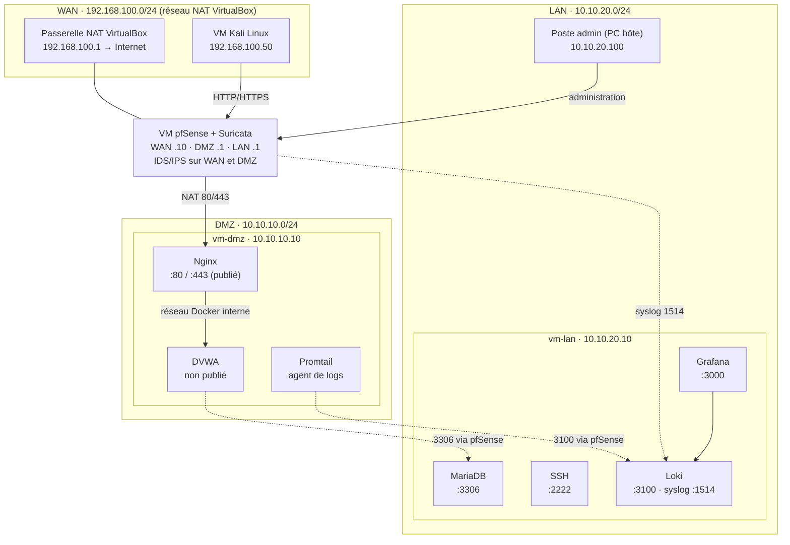

# Projet Security 2026-2027 — Architecture et justifications

> Jalon J1 – CADRER · Document de travail de l'équipe
> Objet : décrire l'architecture du lab (WAN / DMZ / LAN), le plan d'adressage, les flux autorisés, et justifier le placement de chaque service ainsi que les choix techniques.

---

## 1. Synthèse des décisions

| Décision | Choix retenu | Raison principale |
|---|---|---|
| Orchestration des services | **Docker Compose** | Suffisant, reproductible, versionnable ; Kubernetes est explicitement « hors socle » (§16 du sujet) |
| Virtualisation | **VirtualBox + Vagrant** | `vagrant destroy && vagrant up` = reconstruction complète, critère le plus pondéré (20 %) |
| Pare-feu / routage | **pfSense** (imposé) | Configuration restaurée depuis un `config.xml` versionné et nettoyé des secrets |
| Détection | **Suricata en paquet pfSense** | Placé en coupure sur les interfaces, ce qui rend possible la démonstration IPS |
| Collecte / visualisation | **Loki + Promtail + Grafana** | Bien plus léger qu'ELK (Elasticsearch seul demande 2 à 4 Go) |
| Services applicatifs | **Nginx, DVWA, MariaDB, SSH** | Simples à déployer et formant un scénario cohérent (voir §5) |
| Répartition matérielle | **Lab complet sur 1 PC**, 2ᵉ PC pour le redéploiement propre | Évite de relier deux laptops en réseau ; le 2ᵉ PC prouve la reproductibilité |

---

## 2. Schéma d'architecture

**Lecture du schéma**
- Toutes les VM n'ont **qu'une seule carte réseau**, dans leur zone. Tout trafic entre zones passe donc obligatoirement par pfSense, qui le filtre et le fait inspecter par Suricata.
- Les flèches en pointillés sont les **seuls flux de la DMZ vers le LAN** autorisés. Ils sont justifiés au §6.
- DVWA n'a **aucun port publié** : Internet → Nginx → DVWA, un seul point d'entrée.

---

## 3. Plan d'adressage

| Zone | Réseau | Type de réseau VirtualBox | Équipement | IP |
|---|---|---|---|---|
| WAN | 192.168.100.0/24 | Réseau NAT `lab-wan` | Passerelle VirtualBox | .1 |
| | | | pfSense (interface WAN) | .10 (statique) |
| | | | Kali Linux | .50 |
| DMZ | 10.10.10.0/24 | Réseau interne `lab-dmz` | pfSense (OPT1 renommée DMZ) | .1 |
| | | | vm-dmz | .10 |
| LAN | 10.10.20.0/24 | Réseau privé hôte `lab-lan` | pfSense (interface LAN) | .1 |
| | | | vm-lan | .10 |
| | | | PC hôte (poste admin) | .100 |
| Docker DMZ | 172.30.10.0/24 | Réseau Compose interne | Nginx ↔ DVWA | attribution Docker |
| Docker LAN | 172.30.20.0/24 | Réseau Compose | Conteneurs du LAN | attribution Docker |

**Principes d'adressage**
- **IP statiques** pour toutes les VM : chaque reconstruction donne le même résultat et les tests visent des IP fixes.
- **Sous-réseaux Docker figés** (`ipam` dans les fichiers Compose) pour éviter tout chevauchement avec les zones du lab.
- Plages volontairement distinctes et lisibles : `10.10.10.x` = DMZ, `10.10.20.x` = LAN.

---

## 4. Le principe de placement : DMZ ou LAN ?

Pour chaque service, deux questions :

1. **Qui doit pouvoir l'atteindre ?** Si des utilisateurs d'Internet (WAN) doivent l'atteindre → DMZ. Sinon → LAN.
2. **Que se passe-t-il s'il est compromis ?** Un service exposé à Internet sera attaqué tôt ou tard. On le place là où l'attaquant, une fois entré, peut atteindre le moins de choses possible.

La **DMZ** est une zone tampon : on accepte qu'elle soit attaquée, mais elle n'a presque aucun droit vers le LAN.
Le **LAN** contient ce qui a de la valeur (données, administration, logs) et n'est **jamais** joignable depuis le WAN.

Sens des flux :

| Sens | Politique |
|---|---|
| WAN → DMZ | Uniquement ce qui est explicitement publié |
| WAN → LAN | Jamais |
| DMZ → LAN | Strict minimum, port par port, IP par IP |
| LAN → DMZ | Autorisé (administration) |

> Test universel de placement : *« Si ce service est compromis, que peut atteindre l'attaquant ? »* — la bonne réponse est « le moins de choses possible ».

---

## 5. Justification service par service

### 5.1 Services en DMZ

#### Nginx — reverse proxy
- **Qui y accède ?** Les utilisateurs externes. C'est la porte d'entrée, le seul service que l'organisation veut exposer.
- **Pourquoi en DMZ ?** Le placer dans le LAN obligerait à ouvrir un NAT du WAN vers le LAN, ce qui viole directement **SEC-01**.
- **Rôle sécurité** : point d'exposition unique, centralisation des logs HTTP, possibilité de filtrage (en-têtes, limitation de débit).
- **Test associé** : SEC-02, seuls les ports 80/443 sont joignables depuis le WAN.

#### DVWA — application web vulnérable
- **Qui y accède ?** Les utilisateurs externes, **uniquement via Nginx**.
- **Pourquoi en DMZ ?** C'est le service le plus susceptible d'être compromis (il est vulnérable par conception). Si une injection SQL ou une injection de commande réussit, l'attaquant se retrouve en DMZ, d'où il ne peut atteindre que MariaDB sur le port 3306.
- **Pourquoi non publié ?** Un seul point d'entrée (Nginx) est plus simple à surveiller et à filtrer.
- **Rôle dans le projet** : cible du pentest (Kali), déclencheur des alertes Suricata (**DET-01**) et de la démonstration IPS.

#### Promtail — agent de collecte (DMZ)
- Ce n'est pas un service exposé mais un **agent** : il doit se trouver là où sont les logs, à côté de Nginx.
- Il se contente d'envoyer les logs vers Loki (voir le choix discutable au §7).

### 5.2 Services dans le LAN

#### MariaDB — base de données
- **Qui y accède ?** Uniquement DVWA. Personne sur Internet n'a besoin de parler directement à la base.
- **Pourquoi dans le LAN ?** Les données sont l'actif le plus précieux : elles vont dans la zone la plus protégée.
- **Effet en cas de compromission de DVWA** : l'attaquant n'obtient qu'un accès SQL sur le port 3306 depuis une seule IP source, pas un accès réseau au serveur.
- **Test associé** : **SEC-03**. La DMZ joint le 3306 de 10.10.20.10 (attendu : OK) ; la DMZ ne joint rien d'autre dans le LAN (attendu : bloqué).

#### SSH — administration
- **Qui y accède ?** Les administrateurs uniquement.
- **Pourquoi dans le LAN ?** L'administration ne doit jamais être exposée à Internet : un SSH ouvert sur le WAN fait partie des surfaces d'attaque les plus scannées.
- **Pourquoi le port 2222 ?** Le port 22 de la VM est déjà occupé par son propre sshd ; le conteneur SSH (le « service » du projet) écoute sur 2222, le port par défaut de l'image `linuxserver/openssh-server`.
- **Tests associés** :
  - Kali (WAN) → 2222 : bloqué (**SEC-01**).
  - DMZ (DVWA compromise) → 2222 : bloqué. **Test de pivot** : un attaquant en DMZ ne peut pas rebondir vers l'administration.

#### Grafana et Loki — supervision
- **Pourquoi dans le LAN ?** Les logs sont la **preuve** de ce qui s'est passé. Si un attaquant en DMZ pouvait les atteindre, il pourrait les effacer ou les falsifier, et l'équipe perdrait sa capacité d'enquête.
- Grafana est un outil interne : aucune raison d'être visible depuis Internet.
- **Exigence associée** : **OBS-01**, l'événement doit être observable.

#### Poste admin — PC hôte
- L'administrateur fait partie de l'organisation : il est « à l'intérieur ».
- C'est depuis le LAN qu'il administre pfSense, la DMZ et le LAN.

### 5.3 Récapitulatif

| Service | Zone | Exposé au WAN | Accédé par | Exigence / test |
|---|---|---|---|---|
| Nginx | DMZ | Oui (80/443 via NAT) | Internet | SEC-02 |
| DVWA | DMZ | Non (derrière Nginx) | Nginx | DET-01, scénario pentest |
| Promtail (DMZ) | DMZ | Non | — | OBS-01 |
| MariaDB | LAN | Non | DVWA uniquement (3306) | SEC-03 |
| SSH | LAN | Non | Admins (LAN) | SEC-01, test de pivot |
| Grafana | LAN | Non | Admins (LAN) | OBS-01 |
| Loki | LAN | Non | Promtail, pfSense, Grafana | OBS-01 |

---

## 6. Matrice des flux

| # | Source | Destination | Port | Décision | Justification |
|---|---|---|---|---|---|
| F1 | WAN | IP WAN de pfSense → 10.10.10.10 | 80, 443 | Autorisé (NAT) | Seul service publié (SEC-02) |
| F2 | WAN | LAN | tous | **Bloqué** | SEC-01 |
| F3 | WAN | DMZ, autres ports | tous | **Bloqué** | SEC-02 |
| F4 | DMZ 10.10.10.10 | 10.10.20.10 | 3306/tcp | Autorisé | DVWA a besoin de sa base (SEC-03) |
| F5 | DMZ 10.10.10.10 | 10.10.20.10 | 3100/tcp | Autorisé | Envoi des logs Nginx vers Loki |
| F6 | DMZ | LAN, autres ports | tous | **Bloqué** | SEC-03, anti-pivot |
| F7 | DMZ | Internet | 80, 443 | Autorisé (à restreindre) | Téléchargement des images Docker, voir limites connues |
| F8 | pfSense | 10.10.20.10 | 1514 | Autorisé | Logs firewall et Suricata envoyés à Loki |
| F9 | LAN | toutes zones | tous | Autorisé | Administration |

Chaque ligne **Bloqué** devient un test (TEST-xx) dans `validate.sh`. Chaque ligne **Autorisé** correspond à une règle pfSense versionnée et revue via une Pull Request.

---

## 7. Choix discutables et compromis assumés

| Choix | Alternative « idéale » | Pourquoi ce compromis | Traitement |
|---|---|---|---|
| MariaDB dans le LAN | Zone « données » dédiée (3ᵉ zone interne) | Une zone de plus = une interface pfSense et de la complexité en plus pour un lab | Amélioration proposée dans le backlog résiduel |
| *(Alternative écartée)* MariaDB en DMZ avec DVWA | — | Plus simple (pas de flux DMZ → LAN), mais les données seraient dans la zone la plus exposée et on perdrait le scénario SEC-03 | Rejeté |
| Grafana / Loki dans le LAN | Zone de supervision dédiée (MGMT) | Économie d'une VM et de RAM sur 16 Go | Documenté dans les limites connues |
| Flux Promtail (DMZ) → Loki (LAN) sur 3100 | Le LAN vient chercher les logs (pull) | Loki fonctionne en mode push ; la DMZ initie donc une connexion vers le LAN | **Risque accepté et borné** (1 port, 1 IP source, 1 destination) — sujet de Security Decision Record |
| PC hôte dans le LAN | Poste admin dans une zone d'administration séparée | Évite une VM supplémentaire | Raccourci de lab, documenté |
| DMZ → Internet en 80/443 | Registre d'images local ou fenêtre d'ouverture limitée au déploiement | Nécessaire pour télécharger les images | Limite connue, piste d'amélioration |

---

## 8. Choix techniques

### 8.1 Docker Compose plutôt que Kubernetes
- Kubernetes est explicitement **hors socle** (§16 du sujet).
- Son coût en RAM (2 à 4 Go pour le seul plan de contrôle) n'est pas soutenable sur des machines de 16 Go.
- Il complique le cycle deploy / reset / reconstruction, qui est le critère le plus pondéré (20 %).
- Docker Compose fournit exactement ce qu'il faut : un fichier versionné, `docker compose up` pour déployer, `docker compose down -v` pour le reset.
- **Versions épinglées** (ex. `mariadb:11.4`, jamais `latest`), conformément au §7 du sujet.

### 8.2 VirtualBox + Vagrant
- Les VM sont décrites dans un `Vagrantfile` versionné, puis provisionnées par scripts (bash ou Ansible).
- `vagrant destroy -f && vagrant up` permet une reconstruction complète et mesurable.
- **pfSense** est la partie la moins automatisable : sa configuration est restaurée depuis un `config.xml` versionné et nettoyé des secrets. Cette étape est recensée comme **intervention manuelle justifiée**.

### 8.3 Loki + Promtail plutôt qu'ELK
- Elasticsearch demande à lui seul 2 à 4 Go de RAM, ce qui est incompatible avec le budget.
- Loki et Promtail sont légers et s'intègrent nativement à Grafana.
- pfSense et Suricata envoient leurs journaux (dont les alertes EVE JSON) en syslog vers Loki.

### 8.4 Suricata en paquet pfSense
- Suricata inspecte directement les interfaces WAN et DMZ de pfSense.
- Le mode IPS en coupure (inline) y est disponible, ce qui permet la démonstration « détection puis blocage » exigée par le socle.

---

## 9. Budget mémoire (lab complet sur un PC de 16 Go)

| Élément | RAM allouée |
|---|---|
| Système hôte | ~4 Go |
| pfSense + Suricata | 2 à 3 Go |
| vm-dmz (Debian minimal + Docker : Nginx, DVWA, Promtail) | 1,5 Go |
| vm-lan (Debian + Docker : MariaDB, SSH, Grafana, Loki) | 2,5 Go |
| Kali Linux | 2 à 3 Go |
| **Total** | **~12 à 14 Go** |

**Usage des deux machines**
- **PC 1** : lab principal.
- **PC 2** : déploiement propre depuis `git clone`. C'est la preuve de reproductibilité (« deux déploiements propres successifs », « un tiers peut reprendre »). Il sert aussi de poste de développement et de lab de secours.

---

## 10. Points de vigilance à la mise en œuvre

- **pfSense** : décocher « Block private networks » sur l'interface WAN. Le WAN du lab est en adressage privé (192.168.100.0/24) ; sans cela, tout le trafic de Kali est bloqué.
- **DVWA** : aucune directive `ports:` dans le fichier Compose. Nginx l'atteint par le réseau Docker interne.
- **VirtualBox** : désactiver le serveur DHCP du réseau privé hôte `lab-lan`. C'est pfSense qui gère ce réseau.
- **Une seule carte réseau par VM** : une VM reliée à deux zones contournerait le pare-feu.
- **Docker** : figer les sous-réseaux (`ipam`) pour éviter tout chevauchement.
- **Secrets** : aucun mot de passe réel dans le dépôt ni dans son historique (`.env` ignoré par git, fichier `.env.example` fourni).

---

## 11. Lien avec les exigences du sujet

| ID | Exigence | Contrôle | Preuve attendue |
|---|---|---|---|
| SEC-01 | Le WAN ne doit pas initier de connexion vers le LAN | Règles pfSense (F2) | Test Kali → LAN bloqué + log firewall |
| SEC-02 | Seuls les services explicitement publiés sont accessibles depuis le WAN | NAT + firewall (F1, F3) | Scan Kali : seuls 80/443 ouverts |
| SEC-03 | DMZ → LAN limité aux besoins justifiés | Segmentation (F4, F5, F6) | 3306 OK, autres ports bloqués, test de pivot SSH |
| DET-01 | Un comportement choisi doit être détecté | Suricata | Injection SQL sur DVWA → alerte |
| OBS-01 | L'événement doit être observable | Loki + Grafana | Alerte visible dans le dashboard |
| REP-01 | Les contrôles reviennent après reconstruction | Vagrant + Compose + `validate.sh` | Mêmes résultats PASS/FAIL après redéploiement sur le PC 2 |
